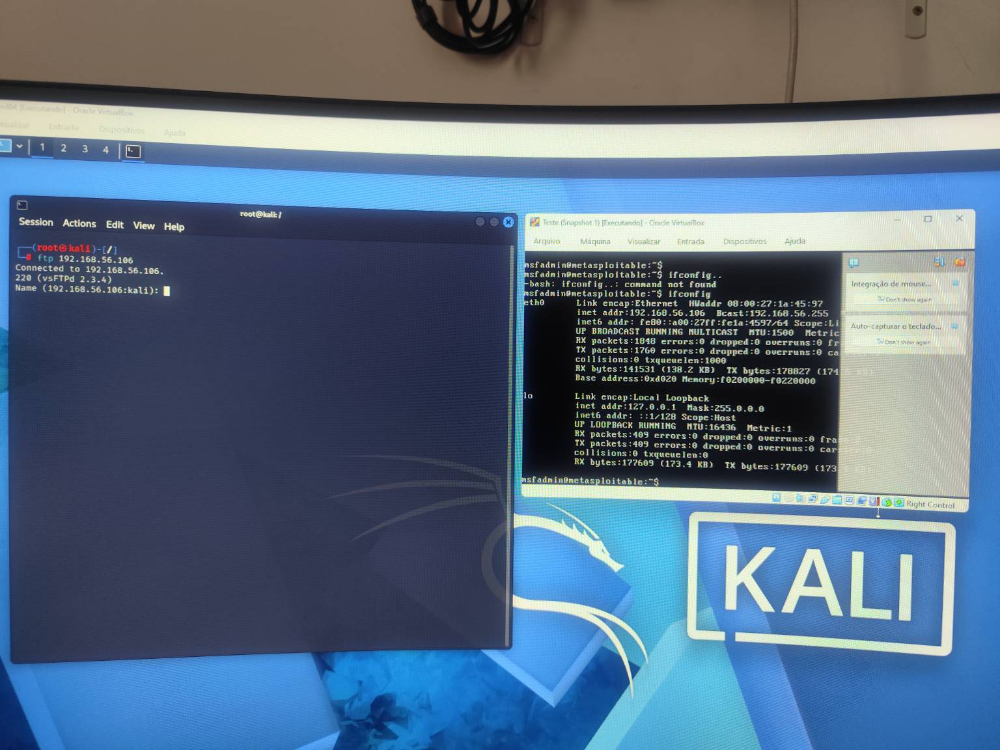
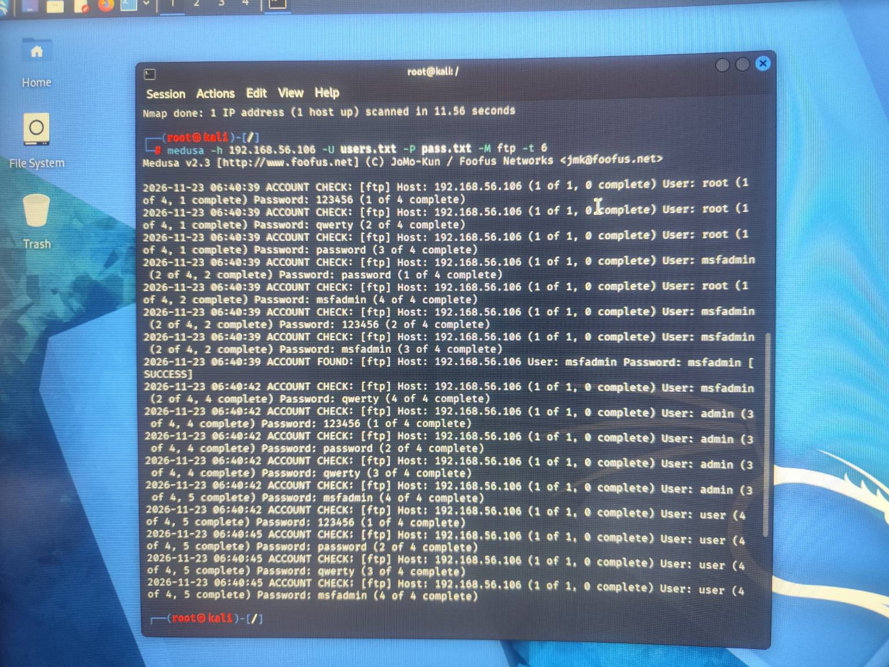

# Desafio de Pentest com Kali Linux e Medusa — Fase 1 (FTP)

 

## 📌 Visão geral

Documentação da **primeira fase** do desafio prático de auditoria de autenticação utilizando **Kali Linux**, **Metasploitable 2**, **Nmap** e **Medusa**, em máquinas virtuais executadas no **Oracle VirtualBox**.

O foco desta etapa foi verificar conectividade, identificar serviços disponíveis e testar, no **FTP do ambiente de laboratório**, uma pequena lista de combinações de usuários e senhas.

> ⚠️ **Uso educacional e autorizado.** Metasploitable é deliberadamente vulnerável. Mantenha a máquina-alvo em rede virtual isolada (por exemplo, *Host-only*), sem exposição à internet. Execute testes apenas em sistemas próprios ou com autorização explícita. As credenciais citadas aqui são credenciais conhecidas do laboratório, não devem ser reutilizadas em serviços reais.

## 🎯 Objetivos da fase 1

- Confirmar a comunicação entre as duas VMs.
- Identificar os serviços FTP, HTTP e SMB por meio do Nmap.
- Criar listas simples de usuários e senhas para o laboratório.
- Realizar um teste controlado de autenticação no FTP com Medusa.
- Registrar evidências e sugerir medidas de mitigação.

## 🖥️ Ambiente utilizado

| Componente | Descrição |
|---|---|
| Sistema de testes | Kali Linux (VM) |
| Alvo de laboratório | Metasploitable (VM) |
| Hipervisor | Oracle VirtualBox |
| Endereço IP do alvo | `192.168.56.106` |
| Interface do alvo | `eth0` |
| Ferramentas | `ping`, `ifconfig`, `nmap`, cliente `ftp`, Medusa v2.3 |
| Data exibida no teste Medusa/Nmap | 23/11/2026 |

**Nota:** os endereços e comandos apresentados refletem esta sessão de laboratório. O IP da VM pode mudar em outras configurações. A captura confirma o IP do alvo, mas não apresenta uma auditoria completa das configurações da rede virtual.

## 🧪 Etapa 1 — Verificação do IP e da conectividade

No Metasploitable, foi executado:

```bash
ifconfig
```

A interface `eth0` apresentou `inet addr:192.168.56.106`.


Em seguida, no Kali:

```bash
ping -c 4 192.168.56.106
```

**Resultado observado:** 4 pacotes transmitidos, 4 recebidos, **0% de perda**; RTT médio de aproximadamente **0,211 ms**.


## 🔎 Etapa 2 — Identificação dos serviços com Nmap

Comando executado no Kali:

```bash
nmap -sV -p 21,80,139,445 192.168.56.106
```

| Porta | Estado | Serviço | Versão/identificação observada |
|---|---|---|---|
| 21/tcp | open | ftp | vsftpd 2.3.4 |
| 80/tcp | open | http | Apache httpd 2.2.8 ((Ubuntu) DAV/2) |
| 139/tcp | open | netbios-ssn | Samba smbd 3.X–4.X (identificação do Nmap) |
| 445/tcp | open | netbios-ssn | Samba smbd 3.X–4.X (identificação do Nmap) |


**Observação:** o Nmap exibiu avisos relacionados à leitura de `/etc/resolv.conf` e à resolução DNS reversa. Mesmo com esses avisos, concluiu a varredura das portas especificadas. A versão Samba mostrada é uma **estimativa** de detecção, não uma confirmação exata.

## 🔐 Etapa 3 — Teste controlado de autenticação FTP

Uma conexão direta ao serviço foi confirmada pelo cliente FTP:

```bash
ftp 192.168.56.106
```

A resposta exibiu `220 (vsFTPd 2.3.4)` e solicitou um nome de usuário.



Foram usadas duas listas curtas, reproduzidas em [`wordlists/users.txt`](wordlists/users.txt) e [`wordlists/pass.txt`](wordlists/pass.txt), apenas com valores públicos e fictícios/de laboratório. Para repetir este exercício **somente na VM autorizada**, o comando mostrado na captura foi:

```bash
medusa -h 192.168.56.106 -U users.txt -P pass.txt -M ftp -t 6
```

> O comando acima foi executado com os arquivos no diretório corrente. Se estiver na raiz deste projeto, utilize `-U wordlists/users.txt -P wordlists/pass.txt`.

**Resultado registrado:** a execução do Medusa v2.3 encontrou uma combinação aceita pelo FTP do Metasploitable:

```text
ACCOUNT FOUND: [ftp] Host: 192.168.56.106 User: msfadmin Password: msfadmin [SUCCESS]
```



A evidência demonstra **autenticação FTP com credenciais fracas/de exemplo**. Ela **não comprova**, isoladamente, acesso root, execução remota de comandos ou exploração de outras vulnerabilidades.

## 🛡️ Análise de risco e mitigação

**Achado da fase 1:** o FTP do laboratório aceitou a combinação conhecida `msfadmin/msfadmin`. Uma senha igual ao nome do usuário é facilmente adivinhável e pode ser encontrada por listas pequenas.

**Medidas recomendadas para ambientes reais:**

1. Eliminar senhas padrão e exigir senhas longas, únicas e não previsíveis.
2. Restringir o serviço FTP a sistemas e usuários que realmente precisam dele; desativá-lo quando desnecessário.
3. Preferir **SFTP** ou outros protocolos protegidos, em vez de FTP tradicional, que não criptografa credenciais.
4. Aplicar limitação de tentativas, bloqueio temporário e monitoramento de falhas de login, conforme o serviço permitir.
5. Segmentar a rede, aplicar firewall e manter sistemas e serviços atualizados.
6. Não expor sistemas intencionalmente vulneráveis, como Metasploitable, à rede pública.

## 📁 Estrutura do repositório

```text
desafio-medusa-kali-fase1/
├── README.md
├── images/
│   ├── 01-ping-kali-metasploitable.jpg
│   ├── 02-ip-metasploitable.jpg
│   ├── 03-nmap-servicos.jpg
│   ├── 04-medusa-ftp-sucesso.jpg
│   └── 05-conexao-ftp.jpg
└── wordlists/
    ├── users.txt
    └── pass.txt
```

## ✅ Conclusão

Nesta primeira fase, a conectividade Kali–Metasploitable foi verificada, os serviços de rede foram enumerados e o teste de autenticação FTP encontrou uma credencial fraca conhecida do ambiente de treinamento. As capturas documentam os resultados.

**Próximas fases (ainda não realizadas nesta documentação):** análise de autenticação SMB e análise de aplicação Web vulnerável em ambiente autorizado, com evidências e mitigação específicas para cada serviço.

## 📚 Referências

- [Kali Linux — site oficial](https://www.kali.org/)
- [Medusa — documentação do projeto](http://www.foofus.net/jmk/medusa/medusa.html)
- [Nmap — manual oficial](https://nmap.org/book/)
- [DVWA — projeto](http://www.dvwa.co.uk/)
- [GitHub — documentação](https://docs.github.com/pt)

---

**Projeto educacional:** desafio DIO de força bruta com Medusa e Kali Linux — entrega parcial (FTP, fase 1). 
